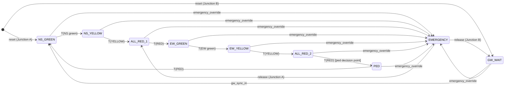

# AMTGC – Final Architecture (as implemented)

This document describes the RTL in `rtl/` exactly as it is now. It replaces the
earlier proposal. Where the proposal and the implementation differed, the
difference and its reason are listed in `docs/bug_log.md`.

## 1. Block diagram

```
                         +------------------------------------------------------+
  clk ------------------>|                     amtgc_top                        |
  rst_n (async, raw) --->|  rst_sync[1:0] (2-flop synchroniser)                 |
                         |     rst_n_sync -----------+-------------+-----------+
                         |                           |             |           |
  emergency_override --->|                           v             v           v
                         |  +--------------------------+    +------------+      |
  density_a[2:0] ------->|  | junction_controller  (A) |    | ped_arbiter|      |
  ped_req_a ------------>|  |  leader, BASE=6 STEP=3   |--->| req_a      |      |
                         |  |  +-----------------+     |<---| grant_a    |      |
                         |  |  | generic_timer   |     |    | (round-    |      |
                         |  |  +-----------------+     |    |  robin on  |      |
                         |  +-----+------------+-------+    |  contests) |      |
                         |        |            | ped_slot   |            |      |
                         |        |            +-----+------+            |      |
                         |        | gw_sync_a        |      |            |      |
                         |        v                  |      |            |      |
                         |  [ green-wave delay line ]|      |            |      |
                         |        | gw_sync_b_in     |      |            |      |
                         |        v                  v      |            |      |
  density_b[2:0] ------->|  +--------------------------+    |            |      |
  ped_req_b ------------>|  | junction_controller  (B) |--->| req_b      |      |
                         |  |  follower, BASE=9 STEP=2 |<---| grant_b    |      |
                         |  |  +-----------------+     |    +------------+      |
                         |  |  | generic_timer   |     |                        |
                         |  |  +-----------------+     |                        |
                         |  +--------------------------+                        |
                         +------------------------------------------------------+
                                  |                              |
                 ns_lights_a, ew_lights_a, ped_walk_a   ns_lights_b, ew_lights_b, ped_walk_b
```

`ped_slot` is Junction A's decision strobe (the last cycle of ALL_RED_2). `amtgc_top` feeds it
to both junctions, so both present their pending pedestrian requests to the shared arbiter in the
same clock cycle. The arbiter has no connection to the strobe or to any junction state; it sees
only `req_a`, `req_b`, `grant_a`, `grant_b`.

Module list (each in its own file, all connections are named):

| File | Module | Role |
|---|---|---|
| `rtl/generic_timer.v` | `generic_timer` | Parameterised up-counter with `done` at `count_target-1`. **Unmodified** since Task 2. |
| `rtl/junction_controller.v` | `junction_controller` | Moore FSM for one junction. Instantiated twice with different parameters. Contains one `generic_timer`, the density-to-split calculation and the pedestrian request latch. |
| `rtl/ped_arbiter.v` | `ped_arbiter` | Shared pedestrian arbiter. Only sees `req_a/req_b` and returns `grant_a/grant_b`. |
| `rtl/amtgc_top.v` | `amtgc_top` | Top level: reset synchroniser, green-wave delay line, both junctions, arbiter. |

## 1a. Why the design is split into these modules

| Module | Why it is a separate module |
|---|---|
| `generic_timer` | Counting is a reusable function with no knowledge of traffic. Keeping it standalone lets one timer serve every phase of both junctions, and it let Task 4 add adaptive timing without touching it (section 6a). |
| `junction_controller` | One junction's phase sequencing is the same logic for A and B. A single parameterised module, instantiated twice with different values, is what makes the reuse real: changing `BASE_GREEN`, `DENSITY_STEP` or any timing parameter changes behaviour with no RTL edit. |
| `ped_arbiter` | The fairness policy is isolated behind a request/grant interface. It can be tested alone (including worst-case starvation), replaced by a different policy without touching a junction, and it cannot depend on junction state because it has no port for it. |
| `amtgc_top` | System-level concerns live here and nowhere else: reset synchroniser, the green-wave delay line, the pedestrian-slot strobe, and parameter choices per junction. The junctions stay unaware of each other. |

### Why the pedestrian controller is shared, not duplicated

A duplicated pedestrian controller per junction would never have to choose between the two junctions: each would
serve its own junction independently, so there would be no fairness decision to make and nothing to verify. The
shared arbiter represents one pedestrian resource that both junctions compete for, with one policy in one place, one
set of corner cases to verify, and less logic. The cost is a throughput bottleneck under simultaneous demand
(bug_log OI-05), which is the price of making the arbitration real.

### How simultaneous pedestrian requests are handled without starvation

1. Both junctions raise their request in the same clock cycle (the pedestrian slot, section 7), so simultaneous
   requests really reach the arbiter together.
2. The arbiter grants at most one. A pointer (`prefer_b`) flips only on contested cycles, so the loser of a contest
   has priority at the next contest. Junction A has no permanent priority.
3. A junction that loses keeps its request pending and presents it at every later slot in which it is armed.
4. Bound: in normal operation a pending request is granted within two slots of the first slot in which it takes
   part (at most 94 cycles after that slot at the default parameters, plus the wait for that first slot). It can lose a contest once, and it wins the next one because it holds the pointer. A junction
   that is waiting in GW_WAIT after an override is not armed and does not compete until it is back in step.
5. Evidence: `tb_ped_arbiter` T2/T3/T4 (alternation, worst-case gap of one cycle, pointer behaviour) and the system
   testbench S4/S8 (120 contested pairs, first-served junction alternates on every contest). Mutants M3 (fixed
   priority) and M13 (last-served pointer) are caught.

## 2. Interfaces

### generic_timer (unchanged)
| Port | Dir | Meaning |
|---|---|---|
| clk, rst_n | in | Clock; asynchronous active-low reset |
| start | in | Count while high; low clears `done` and the counter on the next edge |
| count_target | in | Phase length in cycles minus overhead (see §5) |
| done | out | High once the counter has reached `count_target-1` (1 cycle if target 0) |
| current_count | out | Current count |

### junction_controller
| Port | Dir | Meaning |
|---|---|---|
| clk, rst_n | in | Clock; asynchronous active-low reset (from `rst_n_sync`) |
| emergency_override | in | While high the junction is forced to all-red (EMERGENCY state) |
| traffic_density[2:0] | in | 0 = light, 7 = saturated. Sampled once per signal cycle at NS-green entry |
| ped_req_in | in | Pedestrian button (level). Edge-detected inside the junction |
| ped_grant | in | Grant from the arbiter for this junction's decision point |
| ped_req_out | out | Request to the arbiter. High only during a pedestrian slot, when this junction is armed, has a pending request, has no walk already granted, and no override is active |
| ped_slot_in | in | Shared pedestrian-slot strobe, distributed by `amtgc_top` (Junction A's `ped_slot_out`) |
| ped_slot_out | out | This junction's own decision strobe: high in the last cycle of ALL_RED_2 (not during an override). Only Junction A's is used |
| gw_sync_in | in | Green-wave pulse (Junction B only) |
| gw_sync_out | out | One-cycle pulse at NS-green entry (Junction A) |
| ns_lights, ew_lights | out | 00 red, 01 yellow, 10 green |
| ped_walk | out | Pedestrian walk, high only during a PED slot that was granted |

Parameters: `COUNTER_WIDTH`, `BASE_GREEN`, `MIN_GREEN`, `MAX_GREEN`, `DENSITY_STEP`,
`YELLOW_TIME`, `RED_TIME`, `PED_TIME`, `IS_JUNCTION_B`. No timing constant is
written inside the FSM; all come from parameters or `localparam`s derived from them.

### ped_arbiter
| Port | Dir | Meaning |
|---|---|---|
| clk, rst_n | in | Clock; asynchronous active-low reset |
| req_a, req_b | in | A junction is at its decision point and wants a walk |
| grant_a, grant_b | out | Combinational from the requests. At most one high: one walk is served per slot |

The arbiter has no emergency input, no slot input, and no access to junction states. It knows only
requests and grants. Because both junctions raise their requests in the same cycle (the slot), a
request from each side in the same cycle is a real contest, and the arbiter resolves it.

### amtgc_top
| Port | Dir | Meaning |
|---|---|---|
| clk, rst_n | in | Clock; asynchronous reset (synchronous release) |
| emergency_override | in | System-wide override: both junctions to all-red |
| density_a, density_b | in | Per-junction traffic density |
| ped_req_a, ped_req_b | in | Pedestrian buttons |
| ns_lights_*, ew_lights_*, ped_walk_* | out | Light and walk outputs for each junction |

## 3. Junction state diagram



Outputs are Moore outputs decided by the state only, apart from `ped_walk`, which
is `ped_serve` in PED. `ped_serve` is latched at the decision point.

Light table: NS_GREEN gives NS green; NS_YELLOW gives NS yellow; EW_GREEN and EW_YELLOW
do the same for EW; every other state (ALL_RED_1, ALL_RED_2, PED, EMERGENCY, GW_WAIT)
shows all red.

## 4. Signal cycle and the green-wave link

One signal cycle of either junction:

| Phase | Duration (cycles) |
|---|---|
| NS green | `NS = clamp(BASE + d*STEP, MIN, MAX)` |
| NS yellow | `YELLOW_TIME` |
| All-red 1 | `RED_TIME` |
| EW green | `EW = MIN + MAX - NS` |
| EW yellow | `YELLOW_TIME` |
| All-red 2 | `RED_TIME` |
| Pedestrian slot | `PED_TIME` (always present; walk only if granted) |

Cycle length = `MIN + MAX + 2*YELLOW + 2*RED + PED`. This is **constant for every
density combination**. The green split changes, but the total does not.

Green wave: Junction A emits a one-cycle pulse on NS-green entry. The pulse
passes through a `GW_DELAY_CYCLES-1` stage shift register and reaches Junction B
as `gw_sync_in`. Junction B waits in `GW_WAIT` after reset or an override, and it
enters NS green when the pulse arrives. Because the cycle length is constant, the
offset then holds for every later cycle without any further synchronisation. With
the default `GW_DELAY_CYCLES = 4`, B's NS green begins **4 cycles** after A's NS green.

## 5. Phase timing

The timer counts from its own start, so each phase begins with an *entry cycle* in
which `start` is held low. That clears the timer and masks the stale `done` from the
previous phase. The timer is then loaded with `duration - TIMER_OVERHEAD`
(`TIMER_OVERHEAD = 2`). A phase of D cycles therefore lasts exactly D cycles, for
D ≥ 3. Shorter values are clamped to a 3-cycle minimum.

## 6. Density handling (Task 4)

- `traffic_density` is sampled once, on the edge that ends the entry cycle of NS green.
  The sampled value is held for the whole signal cycle. Changes during the cycle are ignored.
  This is the deliberate decision the specification asks for.
- The NS duration is `clamp(BASE_GREEN + density*DENSITY_STEP, MIN_GREEN, MAX_GREEN)`.
- The EW duration is `MIN_GREEN + MAX_GREEN - NS`. Both directions always receive
  between MIN and MAX cycles, including when both are at density 7 (NS 24, EW 6).

Why the calculation sits in the controller and not in the timer: the timer must stay
a generic down-counter. The meaning of "green" belongs to the junction, so the
controller computes `count_target` and the timer only counts.

## 6a. Where the density calculation is performed, and the generic_timer statement

```
 traffic_density[2:0] --(sampled once, at NS-green entry)--> latched_density
                                                               |
   BASE_GREEN, DENSITY_STEP --> ns_green_dur(): clamp(BASE + d*STEP, MIN_GREEN, MAX_GREEN)  = NS duration
                                                               |
   MIN_GREEN + MAX_GREEN - NS duration                         |   = EW duration
                                                               v
                 to_timer_target(duration) = duration - TIMER_OVERHEAD
                                                               |
                                                               v   count_target
                                                      generic_timer (unchanged)
```

All of this is inside `junction_controller`. It belongs there because "green" and "density" are traffic concepts. The
timer only counts to a target it is given; if it knew about density it would stop being reusable for the yellow, red
and pedestrian phases, which use the same timer with fixed targets.

**Did `generic_timer.v` require any modification? No.** The file is byte-identical to the Task 2 version (checked
with `cmp` against the originally submitted file). The `count_target` input designed in Task 2 was already enough:
the controller computes a different target per phase and per density, and passes it in.

**Density changes during a green phase:** the value sampled at NS-green entry is held for the whole signal cycle and
later changes are ignored. This keeps the green length stable and keeps the cycle length constant. Both greens in
that cycle use the same sampled value.

**Parameter names.** The specification's `GREEN_TIME` is expressed as `BASE_GREEN` (NS green at density 0) with
`MIN_GREEN`, `MAX_GREEN` and `DENSITY_STEP`, so the green length is genuinely a function of parameters.
`YELLOW_TIME`, `RED_TIME` and `PED_TIME` keep the specification's names.

## 7. Pedestrian handling and arbitration (Task 3)

**Requests.** A button press is edge-detected and latched in `ped_pending`. A level held high
gives one request. A press that arrives while one is already pending merges into it.

**Slot.** Once per signal cycle, in the last cycle of Junction A's ALL_RED_2, A raises
`ped_slot_out`. The top level gives this strobe to both junctions. A junction takes part in the
slot only while *armed*: in EW_GREEN, EW_YELLOW or ALL_RED_2, so that the PED slot it is deciding is
its next one. Junction B is in EW_YELLOW when the slot arrives (with the default 4-cycle offset).
After an override B is in GW_WAIT, is not armed, and sits out the slots until it is back in step.

**Arbitration.** In the slot cycle every armed junction with a pending request (and no walk already
granted) raises `ped_req_out`. The arbiter grants at most one. The granted junction clears its pending
flag and records `ped_serve`, which makes `ped_walk` high during its next PED slot (A: the next cycle;
B: four cycles later). The junction that was not granted keeps its request pending and presents it
again at the next slot, one signal cycle (47 cycles at the default parameters) later.

**Fairness.** Round-robin with a pointer (`prefer_b`) that moves only on contested cycles, when both
requests are present together. The loser of a contest has priority at the next contest. A lone request
is always granted and never moves the pointer, so uncontested traffic cannot skew later contests. A
contested requester therefore waits at most one slot behind the other junction. Repeated simultaneous
presses alternate A, B, A, B as the first-served junction, which the system testbench checks over 120
contested pairs.

**Cost.** Under simultaneous demand the shared resource is a real bottleneck: one walk per signal cycle
in total, so each junction is served every second signal cycle (see bug_log OI-05).

**Corner cases.** A request that arrives during yellow waits for the next slot and is neither lost nor
doubled. A request pending during an override stays pending and is served at a later slot. A walk that
has been granted but not yet started (Junction B between the slot and its PED slot) survives an override
and is walked afterwards. A walk that is in progress when an override arrives is cut short and is not
repeated.

## 8. Emergency override (Task 3)

- Sampled on every clock. The next edge moves every junction into EMERGENCY, so the
  lights are all red **one clock cycle** after the override is seen.
- While the override is high, the FSM stays in EMERGENCY. The green-wave delay line is cleared.
- The slot strobe is suppressed during an override, so no pedestrian is granted while it is active.
- On release, Junction A resumes at ALL_RED_1 with a full red interval. Junction B
  resumes at GW_WAIT and stays all-red until A's next NS green. This keeps the offset
  exact. The longest wait is one full signal cycle (47 cycles at the default parameters).

## 9. Reset policy

All outputs (lights and walk) are forced to all-red while the junction is in reset, independent of the clock.

Asynchronous assertion, synchronous de-assertion. The raw `rst_n` clears a 2-flop
synchroniser immediately. The synchronised output releases every block two cycles
after the raw input goes high. Assertion can occur at any time, including mid-count.

## 10. Clocking

Single clock domain, one clock for every block. There are no clock-domain crossings
and no latches. All sequential logic uses non-blocking assignments. Combinational
blocks have default assignments and `default` cases.

## 11. Parameter consistency rule

For the green wave to hold, the two junctions must have the same `MIN_GREEN`,
`MAX_GREEN`, `YELLOW_TIME`, `RED_TIME` and `PED_TIME`. Only `BASE_GREEN`,
`DENSITY_STEP` and `IS_JUNCTION_B` may differ. `GW_DELAY_CYCLES` must also not exceed `YELLOW_TIME + RED_TIME + MIN_GREEN` (12 by default parameters, so the
default of 4 is well inside), so that the slot reaches Junction B while it is armed. These constraints are in the
top-level header and checked by the system testbench, which fails if the offset or the slot alignment breaks.
